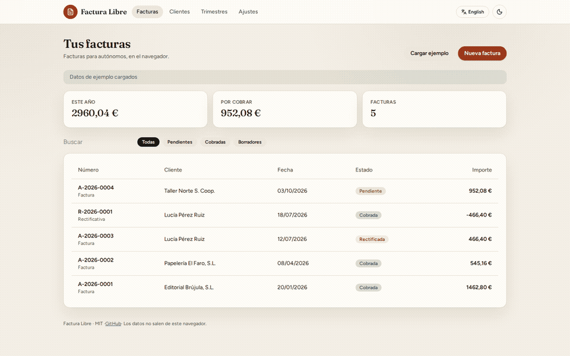
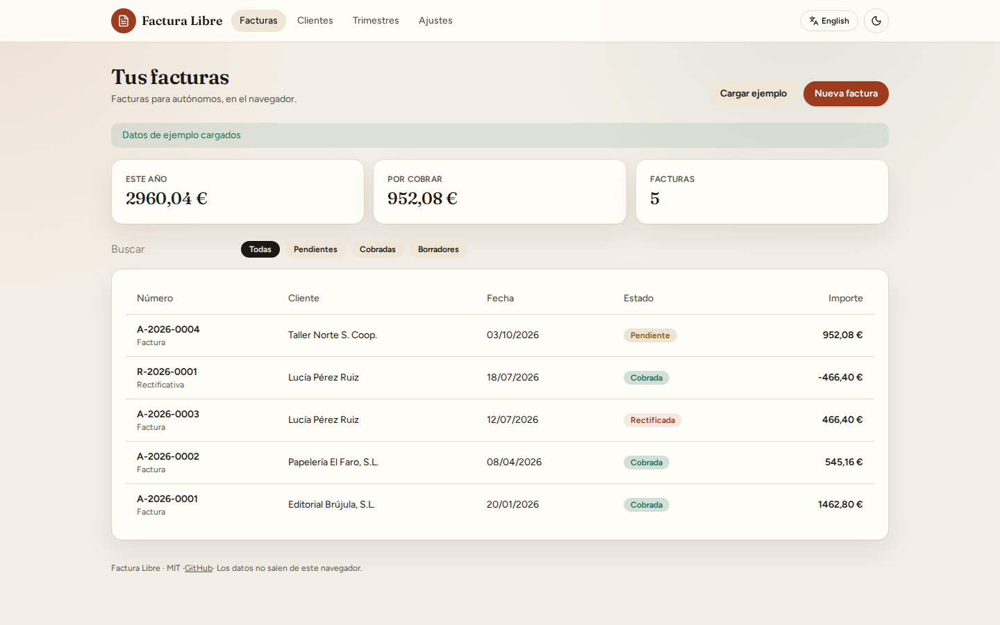
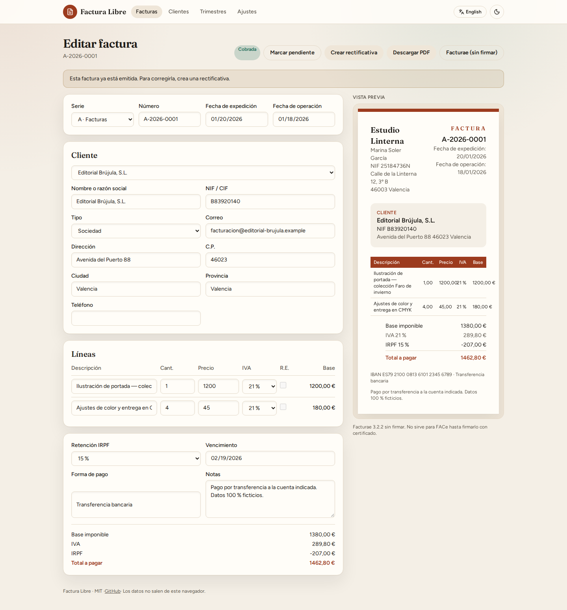
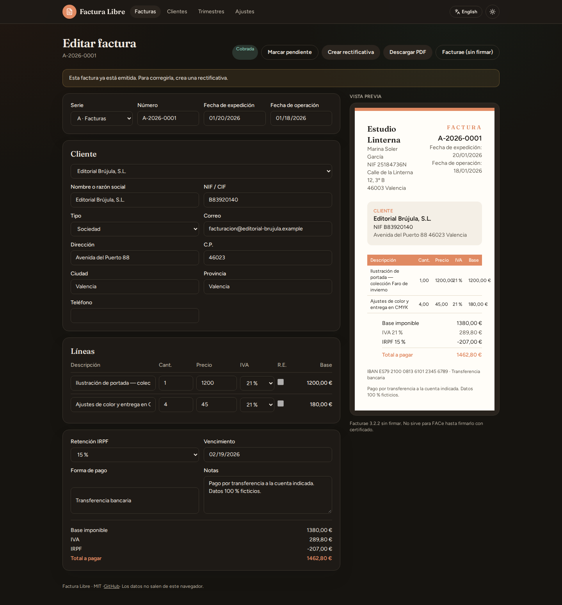

[](https://github.com/serg-hash/Factura-libre/actions/workflows/ci.yml)
[](https://serg-hash.github.io/Factura-libre/)
[](LICENSE)
[](README.md)
[](README.en.md)

# Factura Libre

**Free, offline invoices for Spanish freelancers and small businesses. No account, no server, no fine print.**

Fill in issuer, client and line items (VAT, IRPF withholding, equivalence surcharge), watch the A4 preview, download a clean PDF. Everything stays in IndexedDB. JSON backup and an **unsigned** Facturae 3.2.2 XML are included.

[Open the live demo](https://serg-hash.github.io/Factura-libre/) · [README in Spanish](README.md)



<p align="center">
  
  
</p>
<p align="center">
  
</p>

## This is not certified invoicing software

Factura Libre is a **helper tool**. It is not certified billing software, it does not implement Veri\*Factu, it is not a Ley Antifraude SIF, and the Facturae XML is **unsigned** (not ready for FACe).

Use it to draft, number, keep a local archive and export a quarterly summary. Check with your accountant and current law. If you are required to use a certified system, this repo does not replace it.

## Features

- Complete Spanish invoice fields: issuer/client NIF-CIF, addresses, issue date and operation date.
- VAT 21 / 10 / 4 / 0 per line, IRPF 15 / 7 / 0, optional equivalence surcharge.
- Correlative numbering per series and year (`2026-0001`).
- Credit invoices (facturas rectificativas).
- Paid / unpaid.
- Client-side PDF (pdf-lib) with optional logo.
- Unsigned Facturae 3.2.2, labelled as such.
- Quarterly CSV helpers for form 303 (VAT) and form 130 (IRPF).
- JSON export / import.
- Spanish-first UI, English toggle, light and dark mode.

**Load sample** seeds a fictional Valencia illustrator and made-up clients. No real personal data lives in this repository.

## Honest comparison

| | Factura Libre | [Invoify](https://github.com/al1abb/invoify) | [Invoice Ninja](https://www.invoiceninja.com/) | Holded (free tier) |
| --- | --- | --- | --- | --- |
| Price | Free, MIT | Free, MIT | OSS self-host / paid cloud | Freemium |
| Data | This browser only | This browser only | Server / cloud | Cloud |
| Spanish VAT / IRPF / surcharge | Yes | Generic tax | Configurable | Yes |
| AEAT-style numbering | Yes | No | Your setup | Yes |
| Credit invoices | Yes | No | Yes | Yes |
| Facturae | Unsigned 3.2.2 XML | No | Not native | Depends on plan |
| Veri\*Factu | **No. We say so.** | N/A | Product-dependent | Vendor marketing |
| Offline PDF | Yes | Needs Chromium when self-hosting PDF | Yes | Cloud |
| Form 303 / 130 helper | Indicative CSV | No | Generic reports | Product reports |
| Templates | One professional layout | 13 templates | Several | Several |
| Static self-host | Pages, Docker, Hostinger | Yes, with Node | Heavier | No |

Invoify is the UX/README quality bar. Factura Libre aims at that bar and specialises in Spain.

## Quick start

Node 20 or 22.

```bash
git clone https://github.com/serg-hash/Factura-libre.git
cd Factura-libre
npm install
npm run dev
```

Open [http://localhost:4321](http://localhost:4321) and click **Load sample**.

The GitHub Pages demo is built with `BASE_PATH=/Factura-libre` (capital F, matching the repository name). On your own domain or Docker use `BASE_PATH=/`.

## Deploy

- Demo: https://serg-hash.github.io/Factura-libre/
- Docker and Pages: [docs/deploy.md](docs/deploy.md)
- <!-- HOSTINGER_PARTNER_URL --> Hostinger (no referral code): [docs/hostinger.md](docs/hostinger.md) · [hostinger.com](https://www.hostinger.com/)

## License

[MIT](LICENSE) © 2026 Sergio ([serg-hash](https://github.com/serg-hash))
