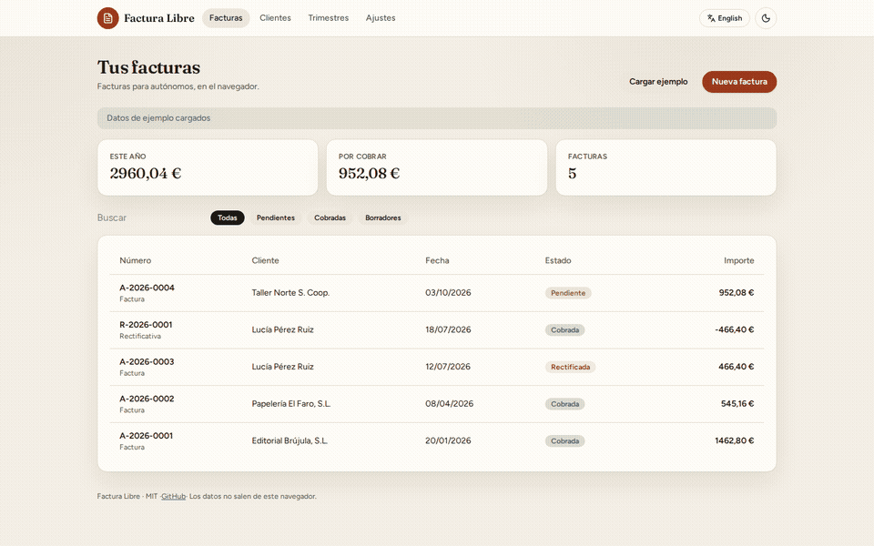
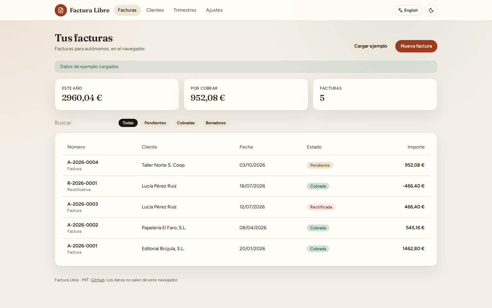
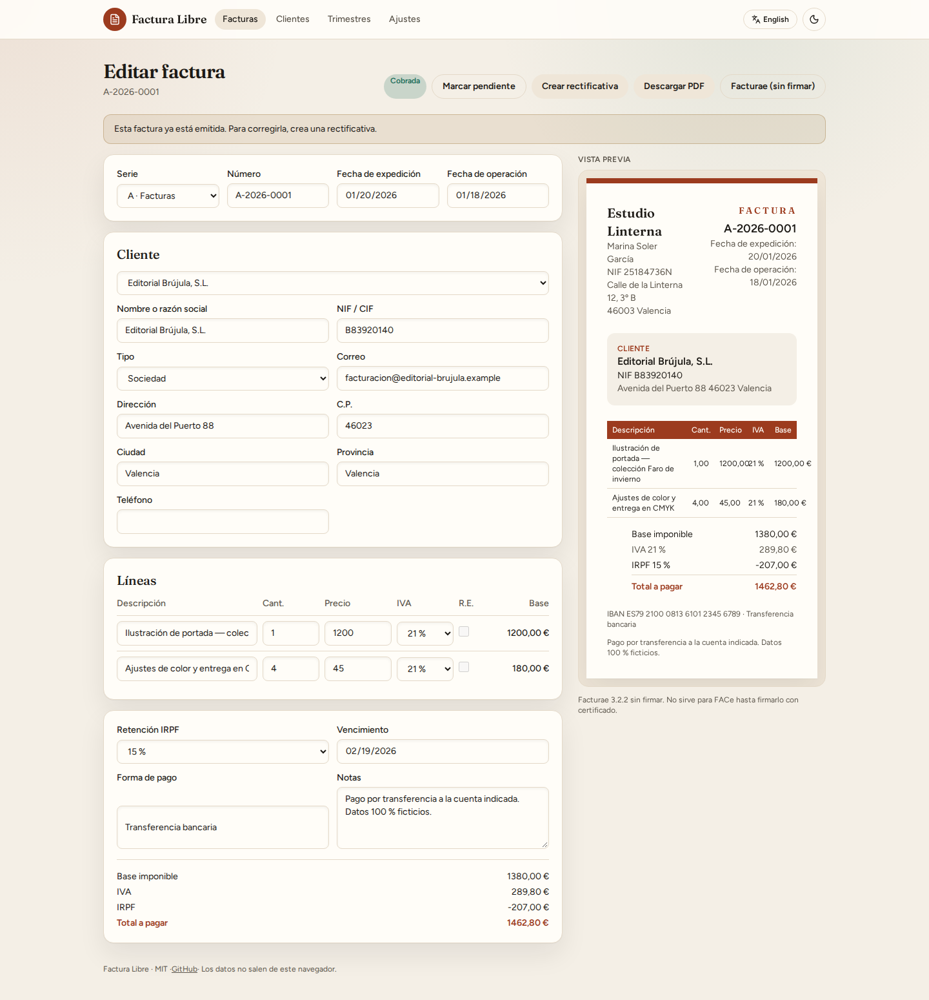
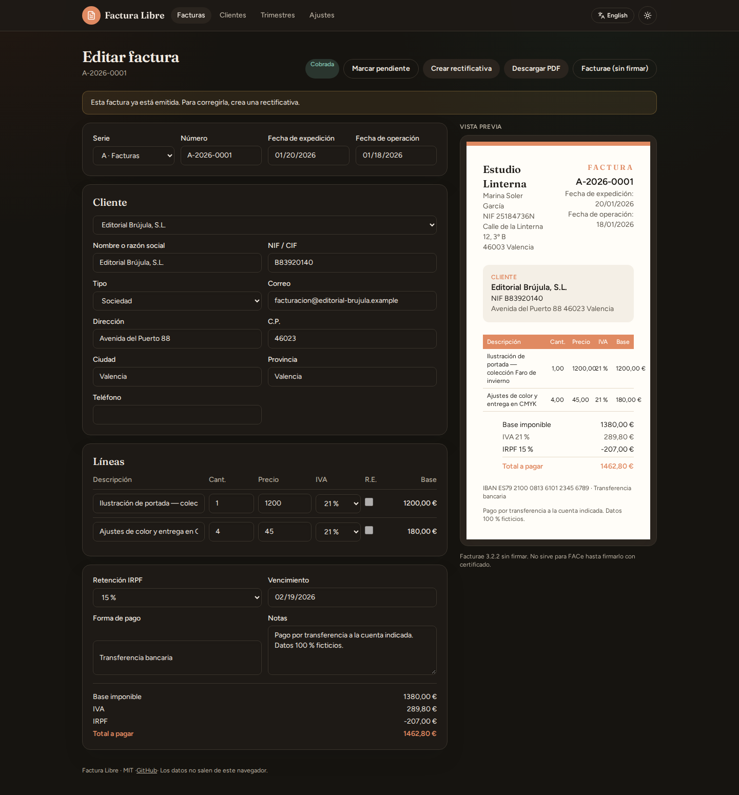

[](https://github.com/serg-hash/Factura-libre/actions/workflows/ci.yml)
[](https://serg-hash.github.io/Factura-libre/)
[](LICENSE)
[](README.md)
[](README.en.md)

# Factura Libre

**Facturas para autónomos y pymes en España, gratis y en el navegador. Sin cuenta, sin servidor, sin letra pequeña.**

Rellena emisor, cliente y líneas (IVA, IRPF, recargo de equivalencia), mira la vista previa A4 y descarga un PDF limpio. Todo se queda en tu IndexedDB. Hay copia JSON y un XML Facturae 3.2.2 **sin firmar**.

[Abrir la demo](https://serg-hash.github.io/Factura-libre/) · [English README](README.en.md)



<p align="center">
  
  
</p>
<p align="center">
  
</p>

## Esto no es un programa certificado

Factura Libre es una **herramienta de ayuda**. No es software de facturación certificado, no implementa Veri\*Factu, no es un SIF de la Ley Antifraude y el XML Facturae **no va firmado** (no sirve para FACe tal cual).

Úsalo para redactar, numerar, archivar en local y llevar un resumen trimestral. Contrasta siempre con tu **gestor** y con la normativa vigente. Si Hacienda te exige un sistema certificado, este repo no lo sustituye.

## Para qué sirve

- **Factura completa de autónomo:** NIF/CIF del emisor y del cliente, domicilio, fecha de expedición y fecha de operación, descripción, tipos y cuotas.
- **IVA 21 / 10 / 4 / 0** por línea, **IRPF 15 / 7 / 0** a nivel de factura, **recargo de equivalencia** opcional (5,2 / 1,4 / 0,5).
- **Numeración correlativa** por serie y año: `2026-0001` o `A-2026-0001`.
- **Facturas rectificativas** que anulan o corrigen una emitida.
- **Cobrada / pendiente.**
- **PDF** generado en el cliente con pdf-lib y logo opcional.
- **Facturae 3.2.2 sin firmar**, etiquetado como tal.
- **Resumen trimestral + CSV** orientativo para el modelo 303 (IVA) y el 130 (IRPF).
- **Exportar / importar JSON** para cambiar de navegador o de disco.
- **Español primero**, inglés con un clic. Claro / oscuro. Responsive.

Carga **Cargar ejemplo** para ver a Marina Soler García, ilustradora ficticia de Valencia, y cuatro clientes inventados. No hay datos personales reales en el repo.

## Comparación honesta

| | Factura Libre | [Invoify](https://github.com/al1abb/invoify) | [Invoice Ninja](https://www.invoiceninja.com/) | Holded (plan gratuito) |
| --- | --- | --- | --- | --- |
| Precio | Gratis, MIT | Gratis, MIT | OSS autoalojado / cloud de pago | Freemium |
| Datos | Solo tu navegador | Solo tu navegador | Servidor / cloud | Cloud |
| IVA / IRPF / R.E. España | Sí | Impuesto genérico | Configurable, no nace en español | Sí |
| Numeración `año-número` | Sí | No específica AEAT | Sí, a tu cargo | Sí |
| Rectificativas | Sí | No | Sí | Sí |
| Facturae | XML 3.2.2 **sin firmar** | No | No nativo | Según plan |
| Veri\*Factu / Ley Antifraude | **No. Lo decimos.** | No aplica (no es AEAT) | Depende del producto | Marketing de cumplimiento; no es este repo |
| PDF offline | Sí (pdf-lib) | Sí (Chromium en servidor en self-host) | Sí | En la nube |
| Ayuda modelo 303 / 130 | CSV orientativo | No | Informes genéricos | Informes de producto |
| Plantillas de diseño | 1 profesional | 13 plantillas | Varias | Varias |
| Autohospedaje estático | Sí (Pages, Docker, Hostinger) | Sí, con Node | Más pesado | No |

Invoify es el listón de pulido: demo clara, README sincero, PDF de verdad. Factura Libre copia esa barra y se especializa en **España**.

## Inicio rápido

Hace falta Node 20 o 22.

```bash
git clone https://github.com/serg-hash/Factura-libre.git
cd Factura-libre
npm install
npm run dev
```

Abre [http://localhost:4321](http://localhost:4321), pulsa **Cargar ejemplo** y emite un PDF.

| Comando | Qué hace |
| --- | --- |
| `npm run dev` | Servidor de desarrollo |
| `npm test` | Vitest (totales, redondeo, NIF, numeración) |
| `npm run lint` | ESLint |
| `npm run typecheck` | TypeScript |
| `npm run build` | Sitio estático en `dist/` |
| `npm run screenshots` | Capturas Playwright para este README |

Para la demo en GitHub Pages el build usa `BASE_PATH=/Factura-libre` (el repo se llama `Factura-libre`, con F mayúscula). En un dominio propio o Docker usa `BASE_PATH=/`.

## Cómo se guarda

IndexedDB en el origen: facturas, clientes, emisor y series. Si borras los datos del sitio, se va todo. Por eso existe **Ajustes → Exportar JSON**.

Nada se envía a un servidor de Factura Libre: no hay backend.

## Despliegue

- Demo: [https://serg-hash.github.io/Factura-libre/](https://serg-hash.github.io/Factura-libre/)
- Docker y Pages: [docs/deploy.md](docs/deploy.md)
- <!-- HOSTINGER_PARTNER_URL --> Hostinger (estático, sin código de referido): [docs/hostinger.md](docs/hostinger.md) · [hostinger.com](https://www.hostinger.com/) · [hostinger.es](https://www.hostinger.es/)

```bash
docker build -t factura-libre .
docker run --rm -p 8080:80 factura-libre
```

## Stack

Astro + TypeScript, isla React para el editor, Tailwind, pdf-lib, Vitest, Playwright (capturas), GitHub Actions.

## Contribuir

Ver [CONTRIBUTING.md](CONTRIBUTING.md). Ideas bienvenidas; pull requests con tests, mejor.

## Licencia

[MIT](LICENSE) © 2026 Sergio ([serg-hash](https://github.com/serg-hash))
